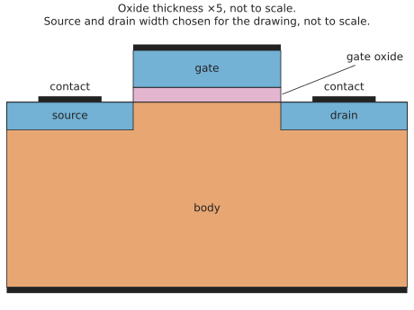
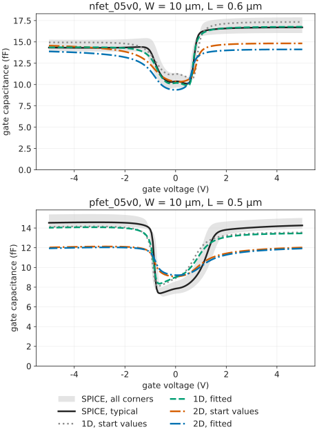

# gf180-tcad

Open-source [TCAD](https://gf180-tcad.readthedocs.io/en/latest/glossary.html#term-TCAD) for the GlobalFoundries
[GF180MCU](https://gf180-tcad.readthedocs.io/en/latest/glossary.html#term-GF180MCU) process ([open PDK](https://github.com/fossi-foundation/gf180mcu-pdk)),
validated against the [PDK](https://gf180-tcad.readthedocs.io/en/latest/glossary.html#term-PDK)'s own [SPICE](https://gf180-tcad.readthedocs.io/en/latest/glossary.html#term-SPICE) models.

## What and why

This project builds a scriptable TCAD flow for GF180MCU transistors. Its 2D cells are cut from
the [gdsfactory](https://gdsfactory.github.io/gdsfactory/) layouts of the PDK's transistor cells,
as in Figure 1, and simulated with [DEVSIM](https://devsim.org/). The project measures how closely
the TCAD agrees with the PDK SPICE models, quantitatively, reproducibly and in public.



*Figure 1. The simulated 2D cell of the `nfet_05v0` at W = 10 µm and L = 0.7 µm, cut along the
gate's length. Blue parts are n-type and the orange body is p-type. `make readme-figures` draws
it from the committed results.*

The PDK's SPICE models are the [reference](https://gf180-tcad.readthedocs.io/en/latest/glossary.html#term-SPICE-reference-results);
the TCAD is what is being tested. Each mismatch is documented with its cause and the evidence
for it, not hidden. Only once the
TCAD has earned confidence will it be used to extend or create SPICE models.

## Status

[Phases 0 and 1](https://gf180-tcad.readthedocs.io/en/latest/glossary.html#term-Phases-0-and-1) are complete: the foundations and the
SPICE reference dataset, regenerated byte-identically on a second host
([check on another computer](https://gf180-tcad.readthedocs.io/en/latest/reproduce/index.html#cross-host-determinism)).
[Phase 2](https://gf180-tcad.readthedocs.io/en/latest/glossary.html#term-Phase-2) (the first TCAD
work) is in progress. The first TCAD results are committed, for the 5 V
[`nfet_05v0`](https://gf180-tcad.readthedocs.io/en/latest/glossary.html#term-nfet_05v0) and
[`pfet_05v0`](https://gf180-tcad.readthedocs.io/en/latest/glossary.html#term-pfet_05v0) at the
uncalibrated start values:

- the 1D [MOS capacitor](https://gf180-tcad.readthedocs.io/en/latest/glossary.html#term-MOSCAP)
  [C–V](https://gf180-tcad.readthedocs.io/en/latest/glossary.html#term-CV) curves
  ([`results/tcad/moscap1d`](results/tcad/moscap1d)) and their
  [mesh convergence](https://gf180-tcad.readthedocs.io/en/latest/glossary.html#term-mesh-convergence)
  ([`results/tcad/meshconv/moscap1d`](results/tcad/meshconv/moscap1d),
  [report](https://gf180-tcad.readthedocs.io/en/latest/limitations/mesh-convergence.html)), made on the
  [dev-HEAD TCAD image](#images);
- the 2D MOS capacitor cut from the PDK's [gdsfactory](https://gdsfactory.github.io/gdsfactory/)
  transistor cells ([`results/tcad/moscap2d`](results/tcad/moscap2d)). It runs at the minimum
  gate length (nfet 0.60 µm, pfet 0.50 µm) and at L = 2 µm, on the
  [stable TCAD image](#images). Its own mesh convergence is in
  [`results/tcad/meshconv/moscap2d`](results/tcad/meshconv/moscap2d).

In 2D the L = 2 µm cell has no small-signal (AC) result: the AC solve fails in the direct solver
at that size. The L = 10 µm cell is not run in 2D, because its equilibrium solve fails there too;
see the [2D MOS capacitor page](https://gf180-tcad.readthedocs.io/en/latest/limitations/moscap2d.html).

The 1D MOS capacitor is calibrated against the SPICE
[Cgg](https://gf180-tcad.readthedocs.io/en/latest/glossary.html#term-Cgg)–Vg
([plan](docs/superpowers/plans/2026-10-18-phase2-gplugins-devsim-moscap.md#task-12-calibrate-against-spice-cggvg),
[`results/tcad/calibration`](results/tcad/calibration),
[`results/tcad/validation`](results/tcad/validation),
[C–V calibration page](https://gf180-tcad.readthedocs.io/en/latest/comparison/cv-agreement.html)):
three tunables, 3 of the 8-parameter budget. In 1D the nfet agrees with SPICE at every geometry,
fitted and held out.

The pfet is published as a disagreement. The SPICE pfet's
[depletion](https://gf180-tcad.readthedocs.io/en/latest/glossary.html#term-depletion) edge
moves by 0.57 V between L = 10 µm and the minimum length. One length-independent 1D stack
cannot follow that. Figure 2 shows both devices at the minimum length. The calibrated 1D curves
are in [`results/tcad/moscap1d`](results/tcad/moscap1d).



*Figure 2. Gate capacitance against gate voltage at the minimum gate length. The solid line is the
SPICE model at the typical corner, inside the grey band of its five corners. The dotted line is
the 1D TCAD at the start values, the dashed line after calibration. It is drawn the same way
as Figure 1.*

Every committed TCAD result has generated
pages (TCAD-against-SPICE overlays, verdicts, mesh convergence), linked from the
[results page](https://gf180-tcad.readthedocs.io/en/latest/results/index.html), and
`make reproduce` includes the TCAD results folders. It has not been run end to end, and its 2D
files are not expected to match
([Reproduce](https://gf180-tcad.readthedocs.io/en/latest/reproduce/index.html#one-command)). The
calibrated 1D [jobs](https://gf180-tcad.readthedocs.io/en/latest/glossary.html#term-job) are cross-checked byte for byte on a
[GitHub-hosted runner](https://docs.github.com/en/actions/concepts/runners/github-hosted-runners)
([TCAD cross-check](https://gf180-tcad.readthedocs.io/en/latest/reproduce/index.html#cross-host-tcad)).

The 2D validation of the calibrated stack is in progress ([issue #35](https://github.com/mithro/gf180-tcad/issues/35)).
The calibrated 2D nfet cells at W10/L0.6, W10/L0.7, W10/L1, W10/L2 and W1.6/L0.7 are committed. They disagree with SPICE
at L = 0.6 and 0.7 µm and are
[Same process](https://gf180-tcad.readthedocs.io/en/latest/glossary.html#term-Same-process) at W10/L1 and W10/L2.
Five calibrated 2D pfet cells are committed. W10/L0.5, W10/L0.7 and W1.6/L0.7 are Same process, and W10/L1 and W10/L2 disagree.

Planned work, each item with its issue, is on the
[roadmap](https://gf180-tcad.readthedocs.io/en/latest/roadmap.html), among it a
[Charon](https://charon.sandia.gov/) backend beside DEVSIM for cross-comparison
([issue #44](https://github.com/mithro/gf180-tcad/issues/44)).
The current limitations, including the deviations from the design spec, are listed on the
[limitations page](https://gf180-tcad.readthedocs.io/en/latest/limitations/index.html).

## Documentation

[](https://gf180-tcad.readthedocs.io/en/latest/)

The documentation is at [gf180-tcad.readthedocs.io](https://gf180-tcad.readthedocs.io/en/latest/). To regenerate the
SPICE reference and the TCAD results yourself, see [Reproduce](https://gf180-tcad.readthedocs.io/en/latest/reproduce/index.html). Its
[check on another computer](https://gf180-tcad.readthedocs.io/en/latest/reproduce/index.html#cross-host-determinism)
section says on which hosts the results are byte-identical.

## Images

Every simulation runs in one of three reproducible images on the
[GitHub Container Registry](https://docs.github.com/en/packages/working-with-a-github-packages-registry/working-with-the-container-registry).
Each is pinned by
[manifest digest](https://gf180-tcad.readthedocs.io/en/latest/glossary.html#term-manifest-digest)
in a one-line file. [`.github/workflows/image.yml`](.github/workflows/image.yml) builds them and
checks that a from-scratch rebuild gives the same digests:

| Image | Pin file | Role |
|---|---|---|
| [`ghcr.io/mithro/gf180-tcad-base`](https://github.com/mithro/gf180-tcad/pkgs/container/gf180-tcad-base) | [`docker/IMAGE`](docker/IMAGE) | the SPICE reference |
| [`ghcr.io/mithro/gf180-tcad-tcad`](https://github.com/mithro/gf180-tcad/pkgs/container/gf180-tcad-tcad) | [`docker/TCAD_IMAGE`](docker/TCAD_IMAGE) | the [stable TCAD image](https://gf180-tcad.readthedocs.io/en/latest/reproduce/image.html#tcad-image) |
| [`ghcr.io/mithro/gf180-tcad-tcad-dev`](https://github.com/mithro/gf180-tcad/pkgs/container/gf180-tcad-tcad-dev) | [`docker/TCAD_DEV_IMAGE`](docker/TCAD_DEV_IMAGE) | the [dev-HEAD TCAD image](https://gf180-tcad.readthedocs.io/en/latest/reproduce/image.html#tcad-dev-image) |

What each holds:

- **base**: [IIC-OSIC-TOOLS](https://hub.docker.com/r/hpretl/iic-osic-tools) with the PDK,
  [ngspice](https://ngspice.sourceforge.io/) and [Xyce](https://xyce.sandia.gov/).
- **stable TCAD**: the TCAD stack at its latest releases.
- **dev-HEAD TCAD**: the TCAD stack at development HEAD (the newest commit), pinned by commit,
  with DEVSIM built from source.

The exact versions in each image are listed in one JSON file per image:
[base](docker/base/versions.json), [stable](docker/tcad/versions.json) and
[dev HEAD](docker/tcad-dev/versions.json). The final results are to come from the dev-HEAD
image; the stable one is kept for checking how the released versions behave. Which results come
from which image today
is on the [image page](https://gf180-tcad.readthedocs.io/en/latest/reproduce/image.html#tcad-results-image).

## Development

Needs [uv](https://docs.astral.sh/uv/); the checks are [pytest](https://docs.pytest.org/) and
[ruff](https://docs.astral.sh/ruff/). Tests marked [`sandbox`](https://gf180-tcad.readthedocs.io/en/latest/glossary.html#term-sandbox) run simulators through
[`tools/sandbox-run`](tools/sandbox-run) and are excluded here.

```
uv sync --locked
uv run --locked python tools/install-hooks
make lint
uv run pytest -m "not sandbox"
```

`make lint` is the lint step of CI; [`tools/install-hooks`](tools/install-hooks) installs the pre-push hook that
runs it and the fast tests before every push ([CONTRIBUTING.md](CONTRIBUTING.md#development)).

See [CONTRIBUTING.md](CONTRIBUTING.md) for the contribution rules.

## Licence

[Apache-2.0](https://www.apache.org/licenses/LICENSE-2.0), see [LICENSE](LICENSE), with one
exception. The patches in [docker/charon-libs/patches/](docker/charon-libs/patches/) change
Charon source code, so they are licensed GPL-3.0-or-later like Charon. They are not under the
Apache-2.0 grant. [docker/charon-libs/README.md](docker/charon-libs/README.md) lists them.
