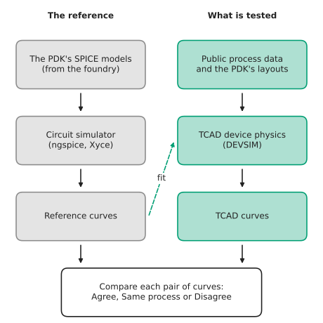
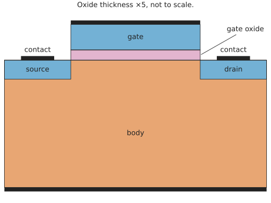
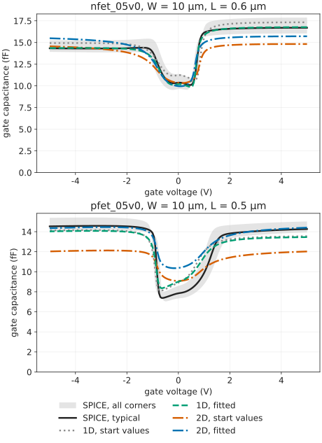

# gf180-tcad

[](https://gf180-tcad.readthedocs.io/en/latest/)

**Can open-source physics simulation, given only public data, reproduce a chip maker's own
transistor models?**

This project tests that for the 5 V transistors of the open
[GF180MCU](https://gf180-tcad.readthedocs.io/en/latest/glossary.html#term-GF180MCU) chip process from GlobalFoundries.

## The question

Chip designers simulate a circuit before it is made. Each transistor in that simulation is a
[SPICE](https://gf180-tcad.readthedocs.io/en/latest/glossary.html#term-SPICE) model: equations the chip maker fits to its own measurements. GlobalFoundries
publishes these models in the [GF180MCU PDK](https://github.com/fossi-foundation/gf180mcu-pdk), an open
[process design kit (PDK)](https://gf180-tcad.readthedocs.io/en/latest/glossary.html#term-PDK).

[TCAD](https://gf180-tcad.readthedocs.io/en/latest/glossary.html#term-TCAD) takes another route. It simulates the physics inside the transistor: its layers,
their thickness, their doping, and the [electrons](https://gf180-tcad.readthedocs.io/en/latest/glossary.html#term-electron) and [holes](https://gf180-tcad.readthedocs.io/en/latest/glossary.html#term-hole) that move in them. This project
builds a TCAD model of the GF180MCU transistors from public sources. It then measures how
closely the TCAD curves match the PDK's SPICE curves (Figure 1).

<picture>
<source media="(prefers-color-scheme: dark)" srcset="docs/images/readme/flow-dark.svg">

</picture>

*Figure 1. The two routes to the same curves. The grey column is the reference, the green column
is what is tested, and every pair of curves is compared at the bottom. The dashed arrow is the
fit: the TCAD's numbers are fitted to the reference curves.*

## How the comparison works

The PDK's SPICE models are the [reference](https://gf180-tcad.readthedocs.io/en/latest/glossary.html#term-SPICE-reference-results), and the TCAD is what
is tested. A circuit simulator runs the SPICE models to give the reference curves. Three TCAD
numbers are fitted to those curves at three gate sizes: the oxide thickness, the body doping and
a voltage shift. The fitted TCAD is then tested in 1D at three sizes it never saw, and in 2D. So
what was fitted stays
apart from what was predicted.

The TCAD runs in two forms. The 1D form is one column down through the gate, its oxide and the
body: the column under the gate in Figure 2. The 2D form is a cross-section along the gate's length. Both run for
the two kinds of 5 V transistor, the [nfet](https://gf180-tcad.readthedocs.io/en/latest/glossary.html#term-nfet_05v0) and the [pfet](https://gf180-tcad.readthedocs.io/en/latest/glossary.html#term-pfet_05v0).

Each pair of curves is judged [Agree](https://gf180-tcad.readthedocs.io/en/latest/glossary.html#term-Agree),
[Same process](https://gf180-tcad.readthedocs.io/en/latest/glossary.html#term-Same-process) or
[Disagree](https://gf180-tcad.readthedocs.io/en/latest/glossary.html#term-Disagree). Same
process means the TCAD lies inside the range the PDK specifies, not at its typical point.

<picture>
<source media="(prefers-color-scheme: dark)" srcset="docs/images/readme/cell-dark.svg">

</picture>

*Figure 2. The simulated cross-section of the [`nfet_05v0`](https://gf180-tcad.readthedocs.io/en/latest/glossary.html#term-nfet_05v0), 10 µm wide with a 0.7 µm gate, cut along the
gate's length. Blue parts are n-type and the orange body is p-type. Oxide thickness ×5, not to
scale.*

## Why it matters

A TCAD model that matches the SPICE models explains them from physics. It can also reach sizes
and devices the models do not cover, once it has earned confidence here. Every mismatch is
listed with its cause and the evidence for it. Every script and result is in the repository,
under an open licence, and every input is pinned to an exact version.

## Where it stands

- **The reference is complete.** The SPICE curves are committed and rebuild byte for byte on a
  second computer.
- **The TCAD covers the gate only.** It simulates how much charge the gate holds as its voltage
  changes, the [C–V](https://gf180-tcad.readthedocs.io/en/latest/glossary.html#term-CV) curve. It has no result for the transistor's current.
- **In 1D the nfet matches and the pfet only in part.** The nfet agrees at every size. The
  pfet disagrees at two of its three fitted sizes (Figure 3) and is Same
  process or Agree at the rest.
- **The 2D cross-sections are mixed.** Each calibrated 2D cross-section is Same process or
  Disagree.
- **No chip has been measured.** No silicon data exists to check either model against.

The [project status](https://gf180-tcad.readthedocs.io/en/latest/limitations/status.html) lists every committed result, its folder and its verdict.

<picture>
<source media="(prefers-color-scheme: dark)" srcset="docs/images/readme/cv-dark.svg">

</picture>

*Figure 3. The gate's capacitance against its voltage at the shortest gate, nfet above and pfet
below. The solid line is the SPICE model, inside the grey band of its 5
[corners](https://gf180-tcad.readthedocs.io/en/latest/glossary.html#term-corner). The dotted and dashed lines are the 1D TCAD before and after fitting.
The dash-dot lines are the 2D cross-section before (orange) and after (blue).*

## Should you read on?

- **You design circuits on GF180MCU:** [Comparison with the PDK](https://gf180-tcad.readthedocs.io/en/latest/comparison/index.html) shows how far the transistor
  models can be rebuilt from physics.
- **You work on open-source TCAD:** [Reproduce](https://gf180-tcad.readthedocs.io/en/latest/reproduce/index.html) rebuilds every result, and
  [Limitations and status](https://gf180-tcad.readthedocs.io/en/latest/limitations/index.html) lists what is missing.
- **You are learning how transistors work:** [How it works](https://gf180-tcad.readthedocs.io/en/latest/explained/index.html) explains each part with this
  process's numbers.

## The documentation

The documentation at [gf180-tcad.readthedocs.io](https://gf180-tcad.readthedocs.io/en/latest/) has five sections, plus a glossary and the API reference:

- [How it works](https://gf180-tcad.readthedocs.io/en/latest/explained/index.html): how a transistor works, with this project's numbers.
- [Reproduce](https://gf180-tcad.readthedocs.io/en/latest/reproduce/index.html): how to rebuild every result.
- [Results](https://gf180-tcad.readthedocs.io/en/latest/results/index.html): the SPICE reference and the TCAD results.
- [Comparison with the PDK](https://gf180-tcad.readthedocs.io/en/latest/comparison/index.html): the TCAD against the PDK, with each verdict.
- [Limitations and status](https://gf180-tcad.readthedocs.io/en/latest/limitations/index.html): what is missing, and the project status.

Planned work, each item with its issue, is on the [roadmap](https://gf180-tcad.readthedocs.io/en/latest/roadmap.html). The [glossary](https://gf180-tcad.readthedocs.io/en/latest/glossary.html) defines
every term.

## Images

The project builds five reproducible images on the
[GitHub Container Registry](https://docs.github.com/en/packages/working-with-a-github-packages-registry/working-with-the-container-registry).
Every committed result comes from one of the first three.
Each is pinned by
[manifest digest](https://gf180-tcad.readthedocs.io/en/latest/glossary.html#term-manifest-digest)
in a one-line file. [`.github/workflows/image.yml`](.github/workflows/image.yml) builds them and
checks that a from-scratch rebuild gives the same digests:

| Image | Pin file | Role |
|---|---|---|
| [`ghcr.io/mithro/gf180-tcad-base`](https://github.com/mithro/gf180-tcad/pkgs/container/gf180-tcad-base) | [`docker/IMAGE`](docker/IMAGE) | the SPICE reference |
| [`ghcr.io/mithro/gf180-tcad-tcad`](https://github.com/mithro/gf180-tcad/pkgs/container/gf180-tcad-tcad) | [`docker/TCAD_IMAGE`](docker/TCAD_IMAGE) | the [stable TCAD image](https://gf180-tcad.readthedocs.io/en/latest/reproduce/image.html#tcad-image) |
| [`ghcr.io/mithro/gf180-tcad-tcad-dev`](https://github.com/mithro/gf180-tcad/pkgs/container/gf180-tcad-tcad-dev) | [`docker/TCAD_DEV_IMAGE`](docker/TCAD_DEV_IMAGE) | the [dev-HEAD TCAD image](https://gf180-tcad.readthedocs.io/en/latest/reproduce/image.html#tcad-dev-image) |
| [`ghcr.io/mithro/gf180-tcad-charon-libs`](https://github.com/mithro/gf180-tcad/pkgs/container/gf180-tcad-charon-libs) | [`docker/CHARON_LIBS_IMAGE`](docker/CHARON_LIBS_IMAGE) | [Charon](https://charon.sandia.gov/) built from source |
| [`ghcr.io/mithro/gf180-tcad-charon`](https://github.com/mithro/gf180-tcad/pkgs/container/gf180-tcad-charon) | [`docker/CHARON_IMAGE`](docker/CHARON_IMAGE) | the [charon image](https://gf180-tcad.readthedocs.io/en/latest/reproduce/image.html#charon-image) |

What each holds:

- **base**: [IIC-OSIC-TOOLS](https://hub.docker.com/r/hpretl/iic-osic-tools) with the PDK,
  [ngspice](https://ngspice.sourceforge.io/) and [Xyce](https://xyce.sandia.gov/).
- **stable TCAD**: the TCAD stack at its latest releases.
- **dev-HEAD TCAD**: the TCAD stack at development HEAD (the newest commit), pinned by commit,
  with [DEVSIM](https://devsim.org/) built from source.
- **charon-libs**: the base image with Charon 2.2.0 and [Trilinos](https://github.com/trilinos/Trilinos) built from source in `/opt/charon`.
- **charon**: the [dev-HEAD TCAD image](https://gf180-tcad.readthedocs.io/en/latest/glossary.html#term-dev-HEAD-TCAD-image) with that `/opt/charon` and [netCDF4](https://github.com/Unidata/netcdf4-python).

The exact versions in each image are listed in one JSON file per image:
[base](docker/base/versions.json), [stable](docker/tcad/versions.json),
[dev HEAD](docker/tcad-dev/versions.json), [charon-libs](docker/charon-libs/versions.json) and
[charon](docker/charon/versions.json). The stable image is kept for checking how the released
versions behave. Which results come from which image
is on the [image page](https://gf180-tcad.readthedocs.io/en/latest/reproduce/image.html#tcad-results-image).

## Development

Needs [uv](https://docs.astral.sh/uv/); the checks are [pytest](https://docs.pytest.org/) and
[ruff](https://docs.astral.sh/ruff/). Tests marked [`sandbox`](https://gf180-tcad.readthedocs.io/en/latest/glossary.html#term-sandbox) run simulators through
[`tools/sandbox-run`](tools/sandbox-run) and are excluded here.

```
uv sync --locked --group docs
make lint
uv run pytest -m "not sandbox"
```

No git hook runs checks at commit or push time. [CI](.github/workflows/ci.yml) runs `make lint`
and the non-sandbox tests on every pull request, and builds the docs
([CONTRIBUTING.md](CONTRIBUTING.md#development)).

See [CONTRIBUTING.md](CONTRIBUTING.md) for the contribution rules.

## Licence

[Apache-2.0](https://www.apache.org/licenses/LICENSE-2.0), see [LICENSE](LICENSE), with one
exception. The patches in [docker/charon-libs/patches/](docker/charon-libs/patches/) change
upstream source code, so each keeps the licence of the files it changes. Charon patches are
GPL-3.0-or-later and [Trilinos](https://github.com/trilinos/Trilinos) patches are
BSD-3-Clause. They are not under the Apache-2.0 grant.
[docker/charon-libs/README.md](docker/charon-libs/README.md) lists them.
